<h1 align="center">Enterprise Credit Risk Modeling &amp; Validation Framework</h1>

<p align="center">
  <b>PD &middot; LGD &middot; EAD &middot; Expected Loss &middot; Scorecard &middot; SHAP &middot; PSI Monitoring</b><br/>
  An end-to-end, Basel-style retail credit risk framework built on 2.26M Lending Club loans.
</p>

<p align="center">
  
  
  
  
  
  
  
</p>

<p align="center">
  <a href="#key-results">Key Results</a> &bull;
  <a href="#architecture">Architecture</a> &bull;
  <a href="#methodology">Methodology</a> &bull;
  <a href="#results">Results</a> &bull;
  <a href="#model-risk-assumptions-and-limitations">Limitations</a> &bull;
  <a href="#getting-started">Getting Started</a>
</p>

<p align="center">
  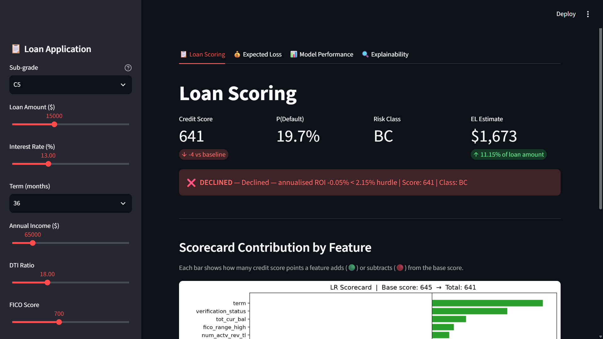
  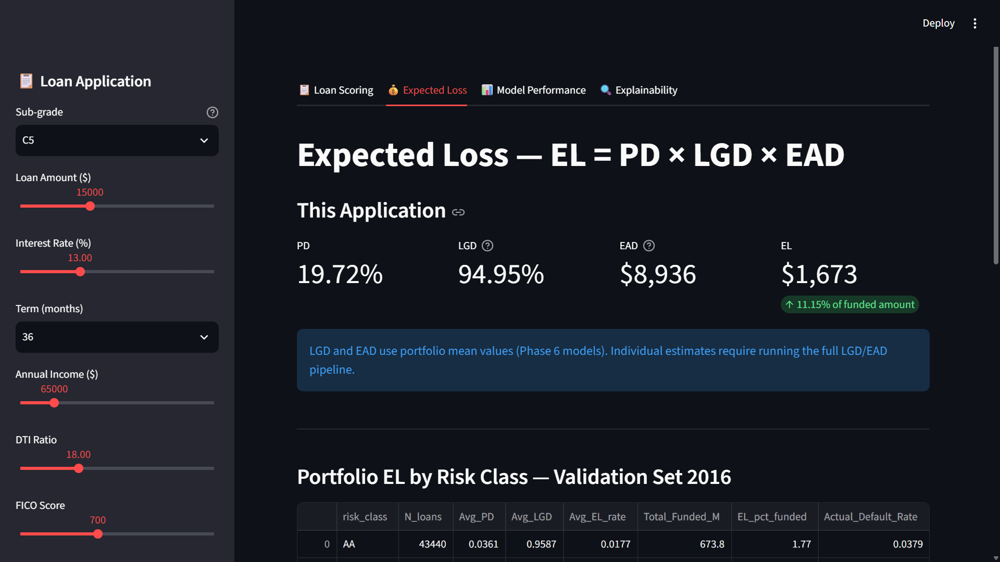
</p>
<p align="center"><i>Interactive Streamlit dashboard: real-time scorecard, Expected Loss, validation charts and explainability.</i></p>

---

## Table of Contents

1. [Overview](#overview)
2. [Key Results](#key-results)
3. [Dataset and Target Definition](#dataset-and-target-definition)
4. [Architecture](#architecture)
5. [Methodology](#methodology)
6. [Results](#results)
7. [Model Risk, Assumptions and Limitations](#model-risk-assumptions-and-limitations)
8. [Roadmap](#roadmap)
9. [Dashboard](#dashboard)
10. [Getting Started](#getting-started)
11. [Repository Structure](#repository-structure)
12. [Technology Stack](#technology-stack)
13. [References and Acknowledgements](#references-and-acknowledgements)
14. [Author](#author)

---

## Overview

Predicting whether a borrower will default answers only one of the three questions a lender needs answered. Pricing, provisioning and approval policy also depend on **how much is exposed** at default and **how much is recovered**. Under the Basel Internal Ratings-Based (IRB) approach these are the three components of Expected Loss:

```
Expected Loss (EL) = PD  x  LGD  x  EAD
                     |       |       |
                     |       |       +-- Exposure at Default (EAD = funded amount x CCF)
                     |       +---------- Loss Given Default  (LGD = 1 - recovery rate)
                     +------------------ Probability of Default (calibrated scorecard)
```

This project implements the full chain on the public Lending Club dataset (2007 to 2018 Q4) and surrounds it with the controls that model-risk teams expect:

- **Out-of-time validation** on a chronological train / validation / OOT split, with WoE bins and encoders fitted on training data only.
- **Four PD model families** (logistic scorecard, Random Forest, XGBoost, Cox PHM) compared on discrimination, calibration and stability.
- **A 300 to 850 points scorecard** whose per-feature contributions can be read as adverse-action style reasons.
- **Two-stage LGD** and **CCF-based EAD** models, combined into loan-level Expected Loss and 10 risk classes.
- **A credit-policy simulation** that converts model output into approve / decline rules.
- **SHAP explainability** and **PSI / CSI monitoring**.
- **A Streamlit dashboard** for scoring a single application and reviewing the portfolio.

The emphasis is on method, calibration, leakage control and honest reporting of limitations, not on maximising a headline AUC. Section [Model Risk, Assumptions and Limitations](#model-risk-assumptions-and-limitations) lists the known weaknesses explicitly.

---

## Key Results

| Area | Result | Notes |
|---|---|---|
| Data | 2,260,638 loans, 47 modeling features | 887,411 train / 434,406 validation / 938,821 OOT |
| PD, production model | Logistic scorecard: OOT AUC **0.698**, KS **0.287**, Gini **0.397** | Best calibration, validation ECE **0.003** |
| PD, challenger | XGBoost: OOT AUC **0.711**, KS **0.306** | ECE 0.279 (uncalibrated, class-weighted) |
| LGD | Combined MAE **6.36 pp** vs 6.50 pp mean baseline | Stage 1 AUC 0.550; R&sup2; &minus;0.025 |
| EAD | CCF MAE **16.70 pp** vs 18.35 pp mean baseline (9% better) | R&sup2; 0.113; under-predicts CCF in every decile |
| Expected Loss | **$673.5M** on $6.40B funded (10.12%), 2016 validation set | Average PD per risk class tracks actual default rate closely |
| Credit policy | Auto-deny riskiest class, auto-approve two safest: EL **&minus;28.0%**, default rate 16.76% &rarr; 14.48% | Historical simulation; see limitations |
| Stability | Score PSI &le; **0.049** for all four models (Train &rarr; OOT) | Only `initial_list_status` drifts materially (0.533) |

> **How to read these numbers.** An AUC near 0.70 is typical for unsecured consumer credit scored on application-time data. The OOT window (2017 to 2018) contains many loans that have not yet matured, so OOT metrics are optimistic; the 2016 validation set is the cleaner performance read. Details in [Limitations](#model-risk-assumptions-and-limitations).

---

## Dataset and Target Definition

**Source:** [Lending Club accepted loans, 2007 to 2018 Q4 (Kaggle)](https://www.kaggle.com/wordsforthewise/lending-club). Peer-to-peer, unsecured personal loans.

| Attribute | Value |
|---|---|
| Loans | 2,260,638 |
| Raw columns / cleaned / modeled | ~150 / 96 / 47 |
| Loan size | $500 to $40,000 |
| Overall bad rate | 12.86% |

**PD target (`default`).** Coded **1 = good, 0 = bad**, following scorecard convention so that positive coefficients mean lower risk.

| Class | Loan statuses |
|---|---|
| Bad (0) | Charged Off, Default, Late (31-120 days), Does not meet the credit policy (Charged Off) |
| Good (1) | Fully Paid, Current, In Grace Period, Late (16-30 days) |

Late (16-30 days) is treated as good because early-stage delinquency often self-cures. Loans that are still *Current* are treated as good because their outcome is not yet known; this is an assumption, discussed under limitations.

**LGD and EAD targets** (defaulted loans only):

- Recovery rate = `recoveries / funded_amnt`, clipped to [0, 1]; **LGD = 1 &minus; recovery rate**.
- Credit Conversion Factor = `(funded_amnt - total_rec_prncp) / funded_amnt`, clipped to [0, 1]; **EAD = funded_amnt x CCF**.

**Chronological split** (hard date boundaries on `issue_d`):

| Split | Period | Loans | Bad rate |
|---|---|---|---|
| Train | Jan 2007 to Dec 2015 | 887,411 | 17.44% |
| Validation | 2016 | 434,406 | 16.76% |
| Out-of-time (OOT) | 2017 to 2018 | 938,821 | 6.74% (right-censored, see limitations) |

<p align="center">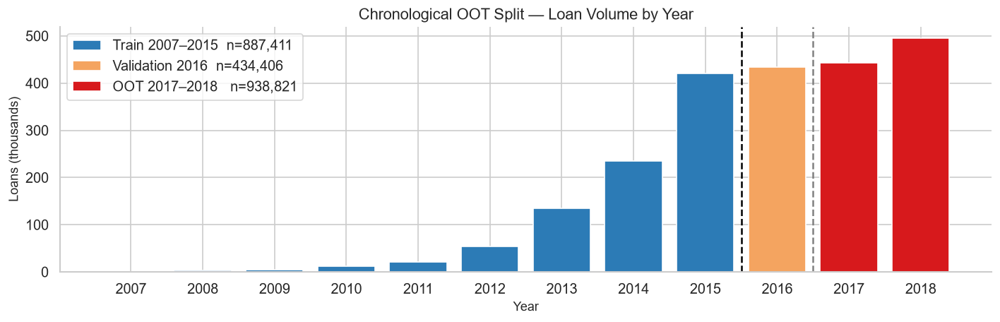</p>

**Cleaning rules** (`src/preprocessing.py`): drop columns with >70% missing values, post-origination leakage columns, identifiers and zero-variance columns; convert `term`, `emp_length`, `int_rate` to numeric; derive `mths_since_earliest_cr_line`; store as parquet.

---

## Architecture

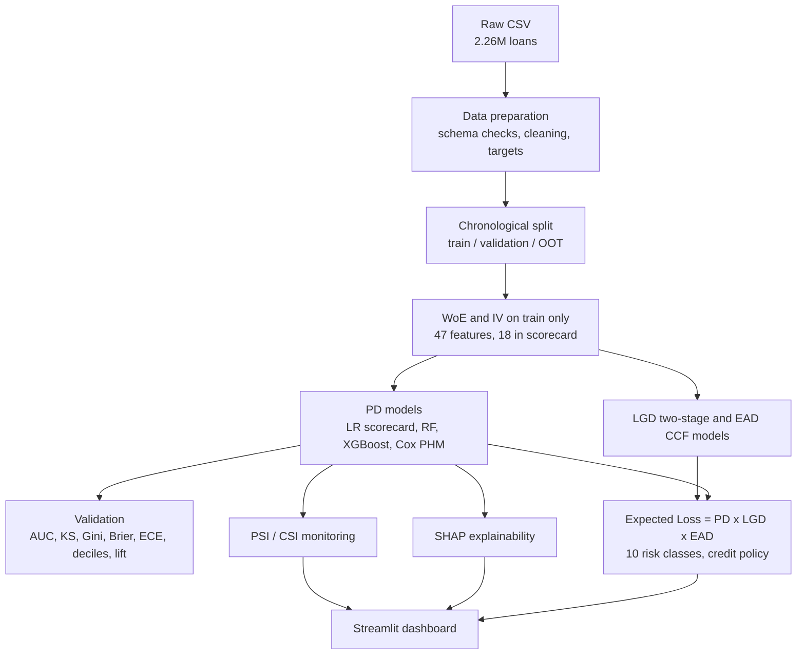

Notebooks `01` to `09` follow this order, and each writes its tables to `artifacts/` and its figures to `reports/`.

---

## Methodology

### 1. Feature engineering and scorecard

Continuous variables are discretised into 10 train-quantile bins; every feature is evaluated with **Weight of Evidence (WoE)** and **Information Value (IV)** fitted on the training set only, then applied to validation and OOT. Of 47 candidate features, 23 have IV &ge; 0.02; **18 are retained** for the scorecard after removing redundant variables (for example `grade`, which duplicates `sub_grade`) and applying p-value based selection in `statsmodels`. Random Forest and XGBoost use all 47 raw features so that every model family is compared on the same input space.

<p align="center">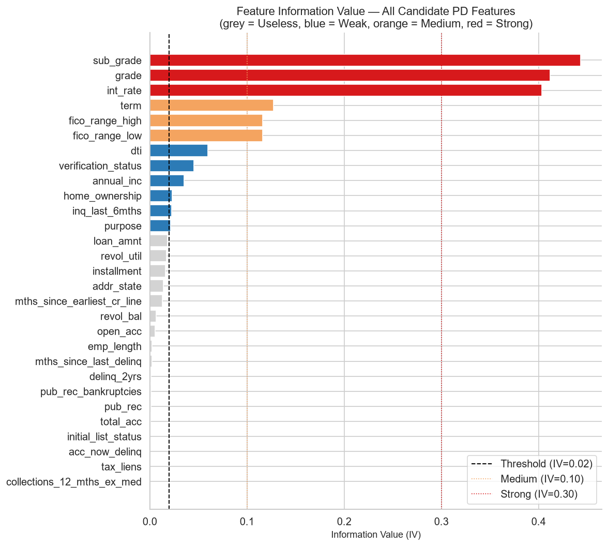</p>

| Feature | IV | Strength |
|---|---|---|
| `sub_grade` | 0.443 | Strong |
| `grade` | 0.412 | Strong |
| `int_rate` | 0.403 | Strong |
| `term` | 0.127 | Medium |
| `fico_range_high` | 0.116 | Medium |
| `acc_open_past_24mths` | 0.084 | Weak |
| `dti` | 0.060 | Weak |
| `verification_status` | 0.046 | Weak |

**Scorecard scaling.** Log-odds of being good are mapped to points with *PDO = 20* and a score of 600 at 1:1 odds:

```
Factor = 20 / ln(2) = 28.854          Offset = 600
Score  = 600 + 28.854 x ( b0 + sum_i b_i x WoE_i )        clipped to [300, 850]
Base score (intercept only) = 645     Each feature adds  28.854 x b_i x WoE_i  points
```

### 2. PD models

| Model | Inputs | Key settings |
|---|---|---|
| Logistic regression (production) | 18 WoE features | `statsmodels` Logit, p-value selection |
| Random Forest | 47 features, ordinal encoding, median imputation | 200 trees, `min_samples_leaf=100`, `class_weight='balanced'` |
| XGBoost | 47 features, ordinal encoding, native NaN handling | 300 trees, depth 6, learning rate 0.05, `scale_pos_weight = n_bad / n_good` (about 0.21 because good = 1) |
| Cox PHM | 18 WoE features | `lifelines`, L2 penalizer 0.1, fitted on a 150K-loan sample |

Hyperparameters are fixed values, not the result of a systematic search (see limitations). SMOTE is deliberately not used; class imbalance is handled with class weights so models train on observed data only.

### 3. Validation

Each model is assessed on both the 2016 validation set and the 2017 to 2018 OOT set using AUC, KS, Gini, Brier score, Expected Calibration Error, calibration curves, decile default rates, lift / gain tables, precision-recall and threshold analysis.

### 4. LGD and EAD

- **LGD, two stages.** A large share of defaulted loans recover nothing (24% in the training set, 39% in validation), so a single regression would be biased. Stage 1 is a class-weighted logistic regression for P(recovery &gt; 0); stage 2 is a linear regression for the recovery rate given recovery.
- **EAD.** Linear regression on the Credit Conversion Factor with one-hot and ordinal encoding (34 application-time features).
- Both are trained on defaulted loans only (154,758 in train, 72,798 in validation) and applied to every loan to compute Expected Loss.

### 5. Expected Loss and credit policy

- Per-loan `EL = PD x LGD x EAD`, with PD from the calibrated scorecard.
- **Risk classes AA to F** are ten equal-size bands of the credit score (about 43,440 loans each).
- **Policy rules:** auto-approve AA and A; auto-deny F; for all other classes approve only if annualised ROI exceeds a 2.15% hurdle, where `ROI = (interest - EL - 2% operating cost) / loan amount / term in years`.

### 6. Explainability and monitoring

- **Scorecard points** give an exact per-loan explanation for the production model.
- **TreeSHAP** explains the XGBoost challenger (computed on a 2,000-loan sample): global importance, beeswarm, waterfall and dependence plots, plus a rank comparison against the scorecard coefficients.
- **PSI** (10 bins on the training distribution) is computed for all four model scores, and **CSI** for every feature, including year-over-year drift.

---

## Results

### PD model comparison

| Model | Val AUC | OOT AUC | Val KS | OOT KS | OOT Gini | Val Brier | Val ECE |
|---|---|---|---|---|---|---|---|
| **Logistic Regression** | 0.6928 | 0.6983 | 0.2783 | 0.2873 | 0.3965 | 0.130 | **0.003** |
| Cox PHM | 0.6948 | 0.6980 | 0.2821 | 0.2892 | 0.3961 | 0.131 | 0.039 |
| Random Forest | 0.6993 | 0.7052 | 0.2877 | 0.2978 | 0.4104 | 0.211 | 0.276 |
| XGBoost | 0.7074 | 0.7108 | 0.3009 | 0.3061 | 0.4216 | 0.214 | 0.279 |

**Decision:** the logistic scorecard is the production model for Expected Loss because EL multiplies PD by LGD and EAD, so the probability must be accurate and not only well ranked. XGBoost is the discrimination challenger; its probabilities would need recalibration before use in EL. The Cox score is a rescaled partial hazard rather than a direct probability, so its ECE and Brier values are indicative only.

<p align="center">
  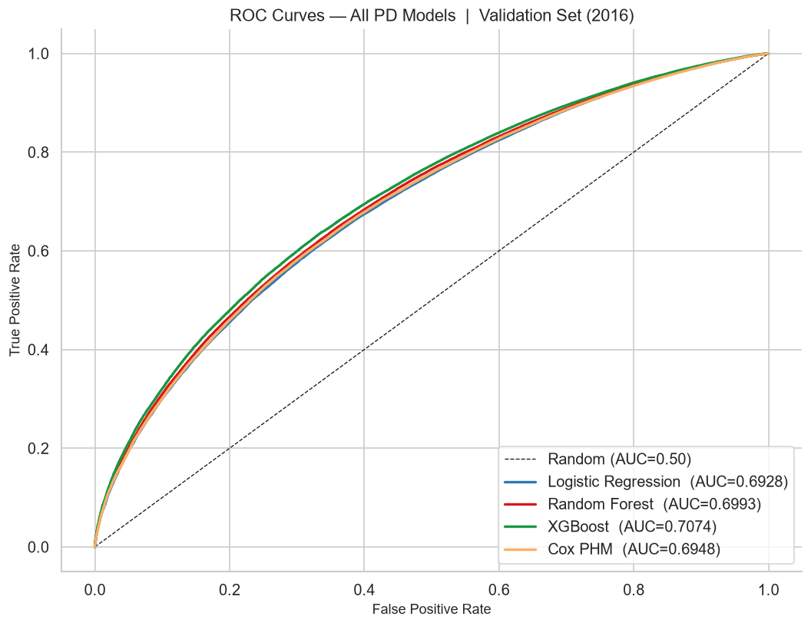
  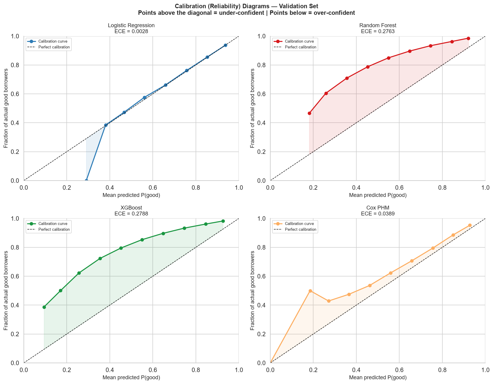
</p>

### Scorecard rank-ordering (validation set)

Bad rate falls monotonically from **37.3%** in the riskiest decile to **3.8%** in the safest, and the three riskiest deciles capture **51.5%** of all defaults. Monotonic ordering also holds on OOT data for all four models.

<p align="center">
  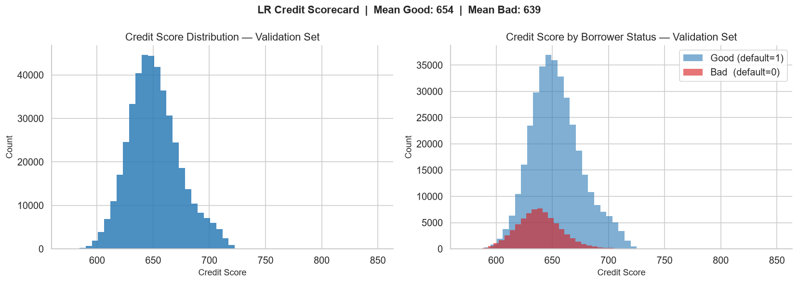
  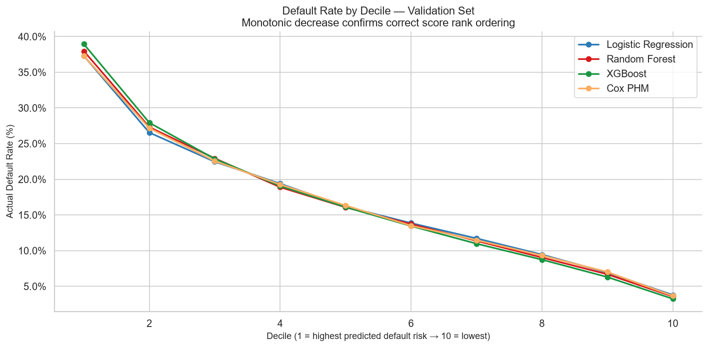
</p>

### LGD and EAD

| Model | Target | Baseline MAE | Model MAE | RMSE | R&sup2; |
|---|---|---|---|---|---|
| LGD stage 1 (logistic) | P(recovery &gt; 0) | | | | AUC 0.550 |
| LGD stage 2 (linear) | recovery rate given &gt; 0 | 5.19 pp | 5.20 pp | | &minus;0.029 |
| **LGD combined** | 1 &minus; recovery rate | 6.50 pp | **6.36 pp** | 9.72 pp | &minus;0.025 |
| **EAD (linear)** | CCF | 18.35 pp | **16.70 pp** | 20.06 pp | 0.113 |

Both models are modest. LGD has almost no loan-level signal (the mean LGD is about 95% because the loans are unsecured), and its RMSE is slightly worse than the mean-only baseline, so it is best read as a **portfolio-level parameter**. On validation defaults the actual mean CCF is 68.98% versus 62.79% predicted.

<p align="center">
  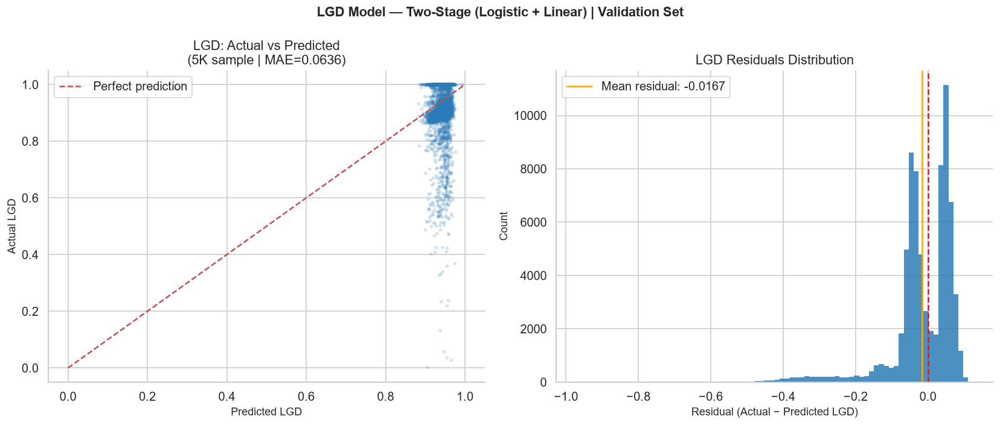
  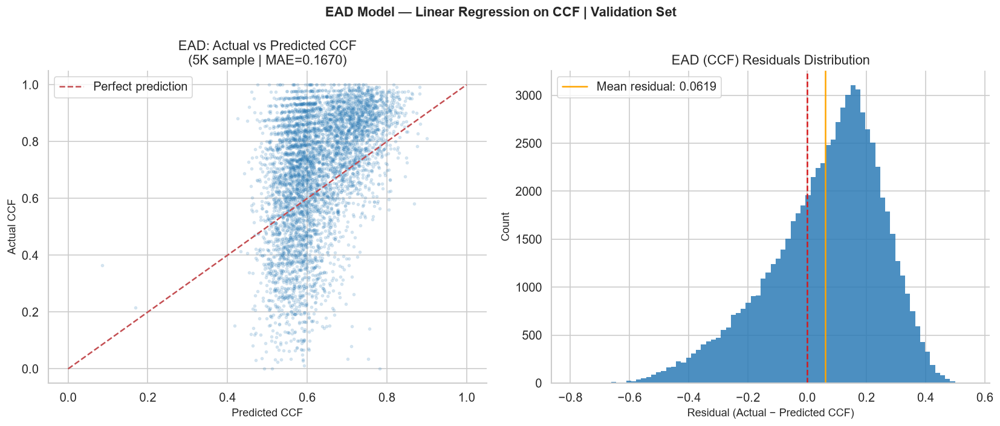
</p>

### Expected Loss by risk class (2016 validation, 434,406 loans, $6.40B funded)

| Class | Avg PD | Actual default rate | EL / funded | Total EL ($M) | Funded ($M) |
|---|---|---|---|---|---|
| AA | 3.6% | 3.79% | 1.77% | 11.9 | 673.8 |
| A | 6.9% | 6.92% | 3.61% | 23.5 | 649.2 |
| AB | 9.5% | 9.45% | 5.12% | 32.3 | 630.4 |
| BB | 11.8% | 11.72% | 6.54% | 40.4 | 617.8 |
| B | 14.2% | 13.86% | 8.01% | 49.1 | 613.4 |
| BC | 16.6% | 16.17% | 9.63% | 59.0 | 613.5 |
| C | 19.4% | 19.39% | 11.48% | 70.7 | 615.8 |
| CD | 22.7% | 22.46% | 13.83% | 86.4 | 624.6 |
| DD | 27.4% | 26.55% | 17.34% | 111.5 | 642.9 |
| F | 38.0% | 37.29% | 26.24% | 188.8 | 719.3 |
| **Total** | 17.0% | 16.76% | **10.12%** | **673.5** | **6,400** |

Average predicted PD matches the observed default rate in every class. Class F is 10% of loans but 28% of total EL, and the top 10% of loans by EL account for **35.1%** of portfolio EL.

<p align="center">
  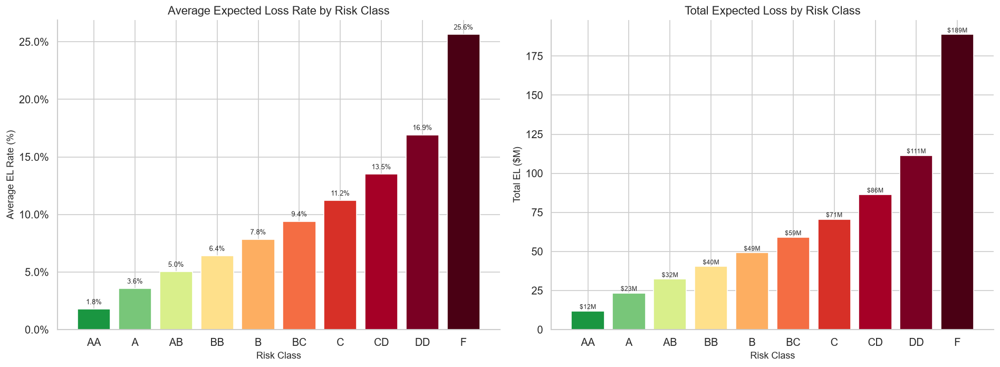
</p>

### Credit policy simulation

| Metric | Before | After policy |
|---|---|---|
| Loans | 434,406 | 390,898 (&minus;10.0%) |
| Default rate | 16.76% | 14.48% |
| Total EL | $673.5M | $484.6M (**&minus;28.0%**) |
| Mean EL rate | 10.12% | 8.40% |

The ROI hurdle rarely binds (67 loans), so the policy is effectively "approve AA / A, deny F". As a sensitivity check, denying the riskiest *x*% of loans by EL gives:

| Denied | 5% | 10% | 15% | 20% | 30% |
|---|---|---|---|---|---|
| EL reduction | &minus;17.7% | &minus;29.5% | &minus;38.8% | &minus;46.5% | &minus;59.2% |

The difference between &minus;28.0% (rules-based, exactly class F) and &minus;29.5% (pure top-10% by loan-level EL) is expected. Savings come from avoided losses only; revenue lost on denied loans is not modeled.

<p align="center">
  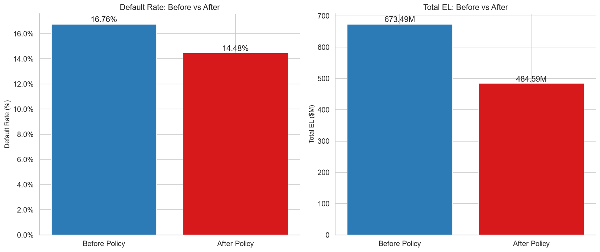
  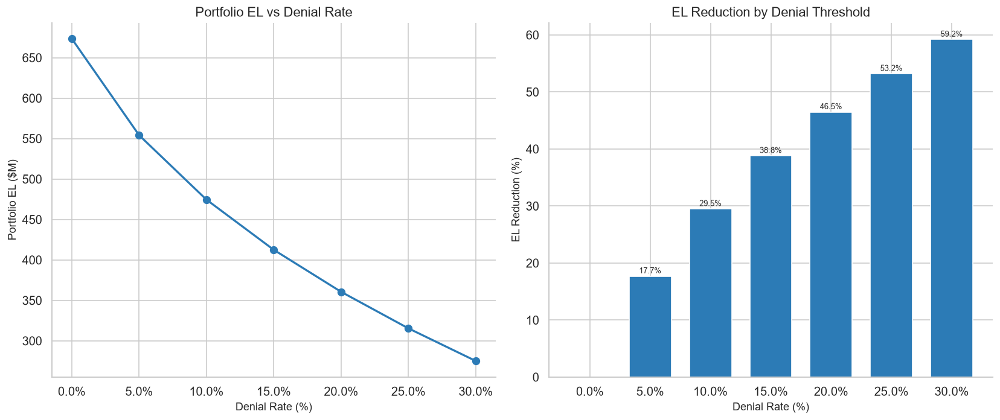
</p>

### Explainability

`sub_grade` is the dominant driver in both frameworks. In XGBoost, mean |SHAP| ranks `sub_grade` (0.258), `acc_open_past_24mths` (0.143), `term` (0.130), `dti` (0.116) and `loan_amnt` (0.109) highest. The scorecard and SHAP agree on the main drivers (`sub_grade`, `term`, `dti`, `annual_inc`) and diverge on weak features, for example `inq_last_6mths` (rank 8 in the scorecard, rank 28 in SHAP).

<p align="center">
  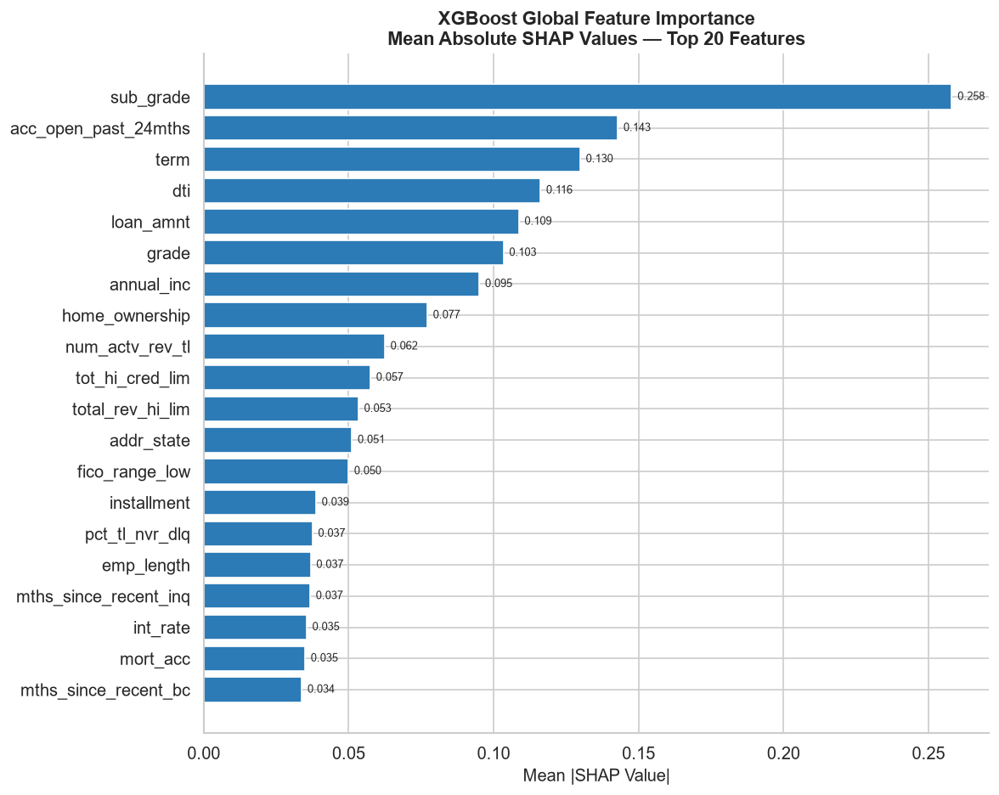
  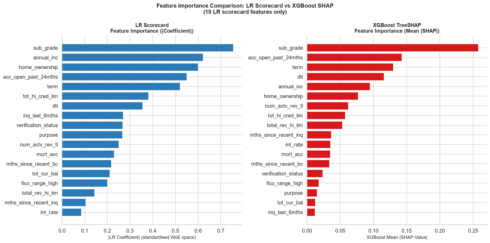
</p>

### Monitoring (PSI, Train &rarr; OOT)

| Scope | PSI | Status |
|---|---|---|
| Logistic Regression score | 0.049 | Stable |
| Random Forest score | 0.043 | Stable |
| XGBoost score | 0.041 | Stable |
| Cox PHM score | 0.032 | Stable |
| `initial_list_status` | 0.533 | Unstable (Lending Club platform change) |
| `bc_util`, `revol_util`, `int_rate` | 0.172, 0.151, 0.124 | Monitor |
| `sub_grade`, `grade` | 0.089, 0.064 | Stable |

Thresholds: below 0.10 stable, 0.10 to 0.25 monitor, above 0.25 investigate. PSI describes score and feature distributions; it does not by itself confirm that predictive performance is unchanged.

<p align="center">
  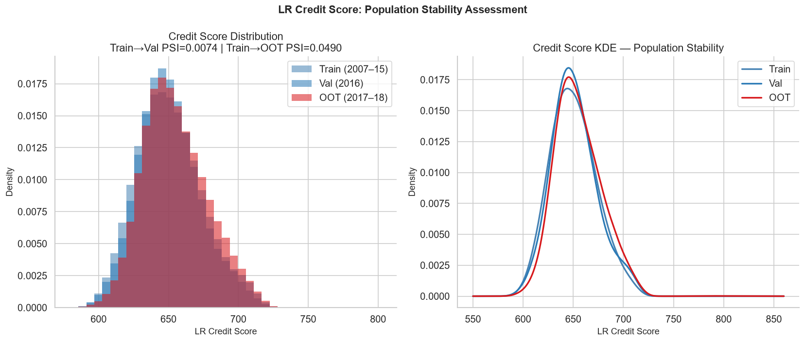
  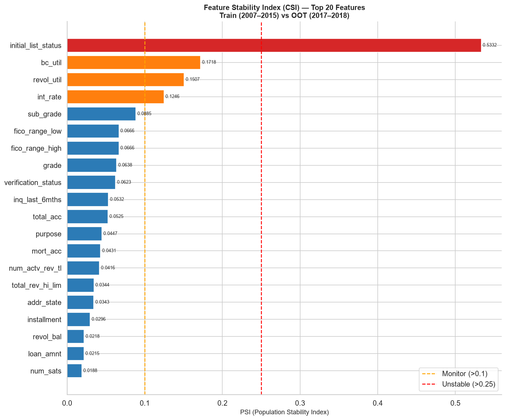
</p>

---

## Model Risk, Assumptions and Limitations

Stating these openly is part of the validation. Each item has a corresponding remedy in the [Roadmap](#roadmap).

| # | Area | Limitation | Impact |
|---|---|---|---|
| 1 | OOT window | Loans issued in 2017 to 2018 that are still *Current* are labelled good, giving a 6.74% bad rate. | OOT metrics are optimistic; AUC and Brier improving from validation to OOT is largely an artifact, not evidence of better performance. Treat 2016 validation as the primary read. |
| 2 | Selection bias | Only accepted loans have outcomes; no reject inference. | Policy results and score behaviour on rejected applicants are unverified. |
| 3 | Model selection | Hyperparameters are fixed values (no cross-validated search); the validation set both monitors XGBoost training and selects the champion. | OOT is the only fully independent test. |
| 4 | LGD | Stage 1 AUC 0.550, R&sup2; &lt; 0, RMSE slightly worse than baseline. Share of defaults with non-zero recovery is 76% in train but 61% in validation, since recoveries on recent charge-offs are still accruing. | Treat LGD as a portfolio parameter; recent-vintage LGD is likely overstated. |
| 5 | EAD | CCF is under-predicted in every decile (bias &minus;4.5 to &minus;9.1 pp); R&sup2; 0.113. | EL is understated where exposure is highest. |
| 6 | LGD definition | Recovery rate uses `funded_amnt` as the denominator, not EAD. | A simplification that overstates LGD relative to exposure. |
| 7 | Tree calibration | RF and XGBoost ECE is about 0.28; they are trained with class re-weighting, which shifts predicted probabilities. | Not usable directly in EL without Platt or isotonic recalibration. |
| 8 | Cox PHM | Defaulted loans use approximate duration (`total_pymnt / installment`), good loans the full term; fitted on a 150K sample; the score is a min-max rescaled partial hazard. | Not a true censored lifetime-PD model; its ECE and Brier are indicative only. |
| 9 | Scorecard hygiene | Four features have VIF &gt; 10 (`sub_grade` 15.6, `tot_hi_cred_lim` 14.9, `int_rate` 14.5, `tot_cur_bal` 11.8); `home_ownership = ANY` is a 3-row bin with WoE 8.3. | Coefficient stability risk; the rare bin should be merged with MORTGAGE. |
| 10 | Dominant features | `sub_grade`, `grade` and `int_rate` are Lending Club's own underwriting outputs. | Part of the predictive signal is the platform's existing risk view. |
| 11 | PD horizon | The target is final loan outcome over the contractual term (36 or 60 months), not a fixed 12-month default. | Not directly a Basel 12-month PD; IFRS 9 staging would need a different target. |
| 12 | Scope | Unsecured peer-to-peer loans, no macroeconomic variables. | Not representative of secured or corporate lending; no stress scenarios. |
| 13 | Dashboard | Fields not exposed in the sidebar use fixed defaults; EL uses portfolio-mean LGD (94.95%) and CCF (59.57%); risk-class cut-offs are fixed PD thresholds approximating the score deciles. | The dashboard is a demonstration, not a production scoring service. |

---

## Roadmap

**Near term**

- Platt or isotonic recalibration of RF and XGBoost on a separate calibration window.
- 12-month performance window for the OOT set, then re-report OOT metrics.
- Merge the `ANY` home-ownership bin; review VIF and coefficient stability; remove the collinear FICO pair from LGD / EAD.
- Bias-correct EAD by CCF decile.
- Nested time-based split so model selection and final testing use separate windows.

**Next**

- IFRS 9 style 12-month and lifetime PD curves from a properly censored survival model.
- Reject inference to address selection bias.
- LightGBM and CatBoost challengers with a model registry.
- Macroeconomic scenarios (GDP, unemployment, rates) for stress-tested Expected Loss.

**Later**

- MLflow or ZenML pipelines with PSI-triggered retraining.
- FastAPI service for real-time scorecard and EL scoring.
- Fixed risk-class boundaries so classes stay stable across retraining.

---

## Dashboard

A four-tab Streamlit application (`dashboard/app.py`):

| Tab | Purpose |
|---|---|
| Loan Scoring | Enter an application; get credit score, PD, risk class, EL estimate, approve / decline reason and per-feature scorecard points |
| Expected Loss | EL = PD x LGD x EAD for the current application (using portfolio-mean LGD and CCF), plus portfolio EL by risk class |
| Model Performance | Model comparison table, ROC, calibration and decile charts |
| Explainability | Global SHAP importance, beeswarm, dependence plots and scorecard comparison |

<p align="center">
  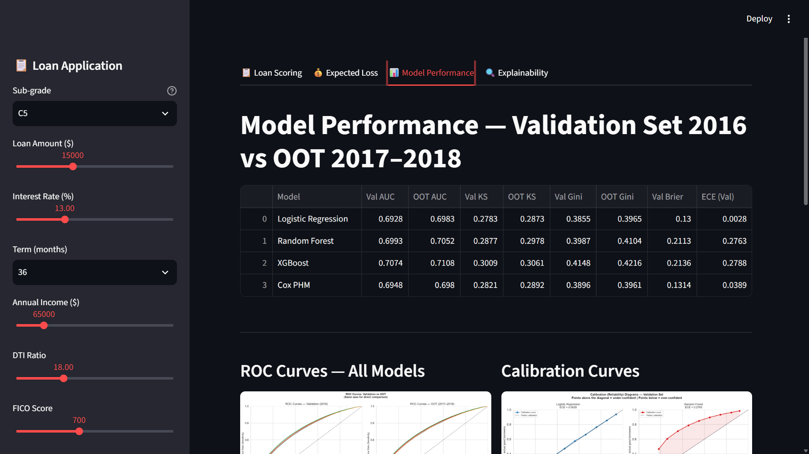
  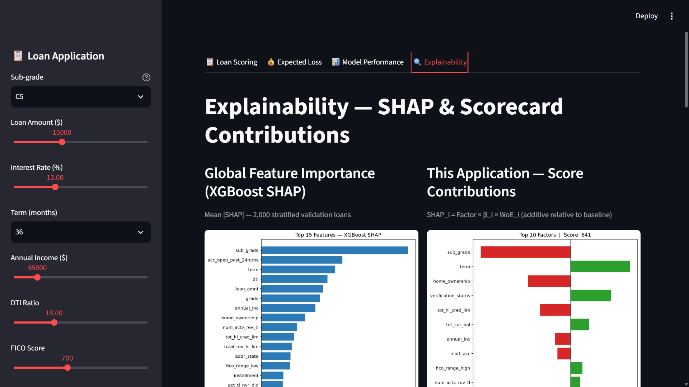
</p>

The dashboard reads `models/pd/lr_params.json` and the tables in `artifacts/`, so it runs without the raw data.

---

## Getting Started

**Prerequisites:** Python 3.10 or newer (developed on 3.11).

```bash
# 1. Clone and enter the repo
git clone https://github.com/<vishalbhura>/Credit_risk_repo.git
cd Credit_risk_repo

# 2. Create and activate a virtual environment
python -m venv .venv
source .venv/bin/activate          # Windows: .venv\Scripts\activate

# 3. Install dependencies and the local package
pip install -r requirements.txt
pip install -e .

# 4. Launch the dashboard (no raw data needed)
python -m streamlit run dashboard/app.py          # http://localhost:8501
```

### Reproducing the full pipeline

1. Download `accepted_2007_to_2018Q4.csv` from [Kaggle](https://www.kaggle.com/wordsforthewise/lending-club) and place it in `data/raw/`.
2. Run the notebooks from the repository root, in order:

| Notebook | Produces |
|---|---|
| `01_data_understanding` | Schema checks, cleaned `data/interim/clean_data.parquet`, targets |
| `02_eda` | Missingness, bad-rate and correlation analysis |
| `03_feature_engineering` | Chronological split, WoE / IV tables, `data/processed/*.parquet` |
| `04_pd_modeling` | LR scorecard, Random Forest, XGBoost, Cox PHM in `models/pd/` |
| `05_model_validation` | Validation tables and charts |
| `06_lgd_ead` | `models/lgd/`, `models/ead/` |
| `07_expected_loss` | Risk classes, EL tables, credit policy and sensitivity |
| `08_shap` | SHAP tables and charts |
| `09_monitoring` | PSI / CSI tables and charts |

Notebooks `01` to `05` are meant to be run in sequence; notebooks `06` to `09` load their inputs from `models/`, `artifacts/` and `data/processed/`.

**Files not stored in git** (regenerated by the notebooks): the raw CSV and parquet files under `data/`, the loan-level outputs `artifacts/credit_policy.csv` and `artifacts/expected_loss_customer.csv`, and the Random Forest model `models/pd/rf_model.joblib` (about 120 MB).

**Reproducibility notes.** Random seeds are fixed (`random_state=42`). Logistic and Cox parameters are saved as JSON and XGBoost in its native JSON format to avoid pickle version incompatibilities across pandas releases; scikit-learn models use `joblib`.

---

## Repository Structure

```
Credit_risk_repo/
├── dashboard/
│   └── app.py                  # Streamlit application (4 tabs)
├── src/
│   ├── data_loader.py          # Raw CSV loading, schema validation, chronological sort
│   ├── preprocessing.py        # Cleaning, targets, OOT split, WoE / IV encoding
│   └── utils.py                # Logging, plot style, figure and model persistence
├── notebooks/                  # 01_data_understanding ... 09_monitoring
├── models/
│   ├── pd/                     # lr_params.json, xgb_model.json, cox_params.json, rf_model.joblib
│   ├── lgd/                    # lgd_models.joblib
│   └── ead/                    # ead_model.joblib
├── artifacts/                  # Metrics, WoE tables, scorecard, EL, policy, PSI tables
├── reports/                    # Figures generated by the notebooks
├── assets/screenshots/         # Dashboard screenshots used in this README
├── data/                       # raw / interim / processed (not tracked)
├── requirements.txt
└── setup.py
```

Data preparation, WoE / IV and the split live in the importable `src/` package; modeling, validation, LGD / EAD, Expected Loss, SHAP and monitoring are implemented in the numbered notebooks.

---

## Technology Stack

| Category | Tools |
|---|---|
| Language | Python 3.11 |
| Data | pandas, NumPy, pyarrow / fastparquet, SciPy |
| Modeling | scikit-learn, XGBoost, statsmodels |
| Survival analysis | lifelines |
| Explainability | SHAP |
| Visualisation | matplotlib, seaborn |
| Application | Streamlit |
| Environment | venv, Jupyter |

---

## References and Acknowledgements

- Methodology for target definition, WoE scorecard scaling, two-stage LGD, CCF-based EAD, the AA to F risk classes and PSI monitoring is adapted from the open-source *Lending-Club-Credit-Scoring* project by Pedro Almeida. The code in this repository is a separate re-implementation extended with Random Forest, XGBoost, Cox PHM, SHAP, calibration and validation analysis, policy simulation and the dashboard.
- Siddiqi, N. *Credit Risk Scorecards: Developing and Implementing Intelligent Credit Scoring*. Wiley, 2006.
- Basel Committee on Banking Supervision, *Basel III* framework and the Internal Ratings-Based approach; IFRS 9 *Financial Instruments* (expected credit loss).
- Data: Lending Club loan data, via [Kaggle](https://www.kaggle.com/wordsforthewise/lending-club).

---

## Author

**Vishal Bhura** &mdash; M.S. (QMS), Data Science &amp; Statistics, Indian Statistical Institute (ISI), Bangalore.

<!-- Add a LICENSE file to the repository, then add a License section here. -->
